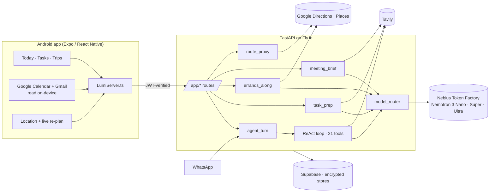

# Meira — the assistant that gets you out of the door on time

**Meira is a local-aware personal secretary.** Tell her your day by voice, in
Hebrew or English, the way you would tell a person. She turns it into a
planned day: every appointment has a route, a leave time and a wake-up alarm.
She watches the clock and your location, and when reality drifts she re-plans
before you have to ask. When you are still at home and the bus has gone, she
already has the next one.

> Built for the **Nebius × NVIDIA Global AI Hackathon**, Personal AI track.
> Runs on **NVIDIA Nemotron 3** (Nano, Super, Ultra) through **Nebius Token
> Factory**. Live research by **Tavily**.

**▶ Demo video:** _link added at submission_ · **📱 Android APK:** [latest release](https://github.com/KoralZakai/Meira/releases/latest)

---

## The problem

Calendars know **what** and **when**. They do not know **how you get there**,
so the gap is filled by you: when do I have to leave? Which bus? Do I have time
between the dentist and the interview across town? I'm still at home and it's
13:40, so what now? For anyone whose day happens in more than one place
(students, field workers, parents, people with ADHD), that mental bookkeeping
is where the day falls apart.

## What Meira does

| | |
|---|---|
| 🎙️ **Talk, don't type** | Speak your day freely ("interview at Rafael on the 8th, reserve duty in Ramla the same day, call Dotan from two to half past two"). A Nemotron *understand* step reads the whole conversation for intent and turns it into actions: add, change or ask. Code executes them, so dates, hours and ranges are exact. |
| 🗺️ **Every appointment is a journey** | Route, leave-home time and a wake-up alarm, by her preferred mode, with a fallback ladder (train → bus) when the preference has no answer. The alarm is visible without a tap. |
| ⏱️ **Live re-planning** | Still at home after the leave time, or late for something that has already started? Meira re-plans from where you are: *"leave now, arrive 21:47 (17 min late)"*, with the next departures one tap away. You get one notification, not a buzz every five minutes. |
| ⚠️ **Clash detection** | Two places at once is a clash; a phone call during a meeting is not. She says which one to keep or move. |
| 🔎 **Meira prepares you** *(new, Tavily)* | For what's next: an interview gets the company, the person and three questions. Karaoke gets songs to practise, with lyrics. A clinic visit gets what to bring and what to ask. Every line cites a live source, and an uncited line is dropped. |
| 🛣️ **Errands on your way** *(new)* | "Fix the coffee machine", "laundry", "pick up a parcel": Meira searches along the routes she already planned, checks each place's opening hours **for the minute you pass it**, and recommends one ("open when you pass at 17:40, ★4.6, 120 m off route"). One tap puts the stop into your day. |
| 📬 **Calendar and email aware** | Google Calendar and Gmail are read **on the phone** with your own token. Invitations become tasks, with the venue read from the invite body when the location field is empty. |
| 💬 **Two doors, one brain** | The Android app and WhatsApp share one agent and one encrypted memory, keyed by a verified identity. |

## How it uses Nemotron on Nebius Token Factory

All model calls run **server-side**; the app ships no model key. Each call is
routed to the smallest Nemotron tier that can do the job
(`server/model_router.py`):

| Tier | Model | Used for |
|---|---|---|
| **Nano** | `nvidia/Nemotron-3-Nano-30B-A3B` | Extraction, intent, *"is this worth preparing?"*, *"is this an errand, and what do I search for on a map?"* |
| **Super** | `nvidia/nemotron-3-super-120b-a12b` | The ReAct agent and its 21 tools, *understand* (conversation → actions), cited briefs and prep |
| **Ultra** | `nvidia/Nemotron-3-Ultra-550b-a55b` | Long-context turns |

- **Budget-aware degradation.** Past 80% of the monthly budget the Ultra tier
  is withdrawn; past 100% everything runs on Nano. Meira degrades, she never
  goes dark.
- **Cache-shaped prompts.** The ~18 KB system prompt is byte-identical across
  users and turns, so the provider's prefix cache applies. Per-user context is
  appended after it (`server/tests/test_prompt_cache.py` guards this).
- **Semantic memory.** Qwen3-Embedding on Nebius retrieves the handful of
  facts relevant to a message instead of sending the whole memory each turn.

**What is deliberately *not* the model's job:** sorting a day, resolving
"tomorrow", time arithmetic, opening-hours math, clash geometry. Those are
deterministic code with tests. The model is used for language and judgement.
That is what makes the times trustworthy.

## How it uses Tavily

| Where | What Tavily provides |
|---|---|
| `server/task_prep.py` | Live sources for preparing any task: songs and lyrics, what to bring, tips. Nemotron plans the queries (about the task, never about you), then composes items that must each cite a source. |
| `server/meeting_brief.py` | The company, its recent news and the person you're meeting, as a cited pre-meeting brief. |
| `server/lumi_agent.py` → `web_search` | The agent's live web tool (Tavily first, Google Custom Search as fallback). |
| `server/agent_runner.py` | Personal agents that run on a schedule and search the web. |

## Architecture



- **Server** (`server/`): FastAPI and a custom ReAct loop (`react_loop.py`),
  about 21 MB on a 256 MB machine. WhatsApp and `/agent/chat` share
  `agent_turn.run_turn`.
- **App** (`src/`): Expo 56 / React Native 0.85, Android. A thin client: it
  sends what you said and renders what came back. There is no model on the
  phone.
- **Routes** go through the server (`route_proxy.py`), so the phone's
  restricted Maps key never has to sign a raw request.

## Privacy and security

- **No secret is stored on disk.** Every server credential is an encrypted Fly
  secret. The APK carries only values that are public by design (the Supabase
  anon key behind row-level security, a package-restricted Maps key).
- **Verified identity.** Every `/app/*` call carries a Supabase JWT, and the
  server derives the storage key from the *verified* identity, never from a
  value the client chose.
- **Encrypted at rest.** Memory, profile, places, briefs and prep are
  encrypted per user (`secure_store.py`).
- **Account deletion covers every store.** A test fails if a new store is added
  without being deleted.
- **Your mailbox never leaves the phone.** Gmail and Calendar are read
  on-device; at most one event, or four subject lines, is sent for a brief.
- **Searches carry no personal data.** Tavily and Places queries describe the
  task ("karaoke songs", "laundromat"), never you.

## Engineering principles (from real bugs)

This project keeps a written rule set, [`CLAUDE.md`](CLAUDE.md) → *The
silent-state rule*, distilled from bugs where the app *knew* something and did
not *say* it:

- An empty result never means two things: "no events" and "Google refused us"
  are different values.
- A check that cannot fail is not a check.
- A plan that exists is visible without a tap.
- Every capability names its trigger (app open, backgrounded, closed, or
  user-initiated).

**Tests:** 85 app test runners (`tests/run-*.ts`) and 66 server test modules
(`server/tests/`, ~800 tests), including personas, language parity
(Hebrew = English behaviour) and real calendar invitations.

## Run it yourself

### Server

```bash
cd server
python3.12 -m venv .venv && . .venv/bin/activate
pip install -r requirements.txt
export NEBIUS_API_KEY=...            # Nebius Token Factory
export TAVILY_API_KEY=...            # optional: prep, briefs, web search
export GOOGLE_MAPS_API_KEY=...       # Directions + Places (server-restricted)
export SUPABASE_URL=... SUPABASE_SERVICE_ROLE_KEY=...
uvicorn main:app --port 8000
python -m pytest -q                  # the server suite
```

Model tiers are configurable: `NEBIUS_MODEL_SMALL`, `NEBIUS_MODEL_MEDIUM`,
`NEBIUS_MODEL_LARGE`. `GET /diag/models` checks that Token Factory serves each
one.

### App (Android)

```bash
npm install
cp .env.example .env.local           # EXPO_PUBLIC_SERVER_URL, Supabase URL + anon key, Maps key
# add your own google-services.json (Firebase) for push notifications
npx expo run:android                 # or: npm run android:local (local EAS build)
npx tsx tests/run-live-route.ts      # any test runner
```

Or install the prebuilt APK from [Releases](https://github.com/KoralZakai/Meira/releases/latest).

## Repository layout

```
server/            FastAPI, ReAct agent, model router, task_prep, errands_along,
                   meeting_brief, route_proxy, encrypted stores, tests/
src/screens/       Today (the planned day), Tasks, Trips, Leave-now, chat, voice
src/services/      LumiServer (the one server surface), live routing, calendar sync
src/utils/         Deterministic planning: clashes, day window, time ranges
tests/             App test runners (npx tsx tests/run-*.ts)
docs/              Privacy policy, security notes
```

## License

[MIT](LICENSE) © 2026 Koral Zakai
